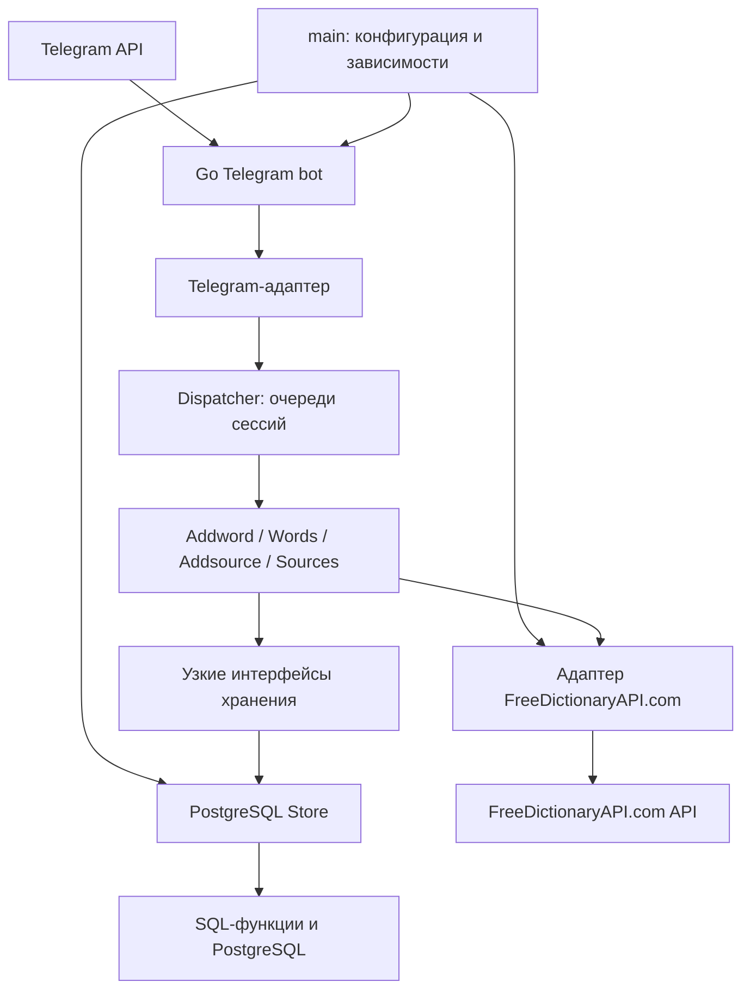
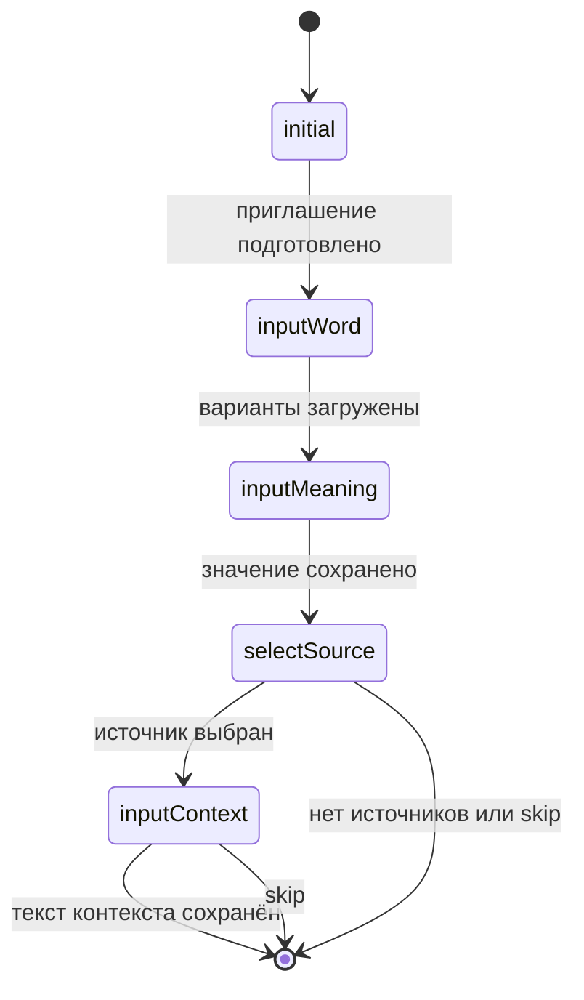

# Архитектура

[README](../README.md) · [Команды](commands.md) · [БД](database.md) · [Решения](decisions.md)

## Компоненты и зависимости



Входной адаптер преобразует обновления Telegram во внутренние сообщения.
Диспетчер ставит их в очереди сессий; обработчик каждой сессии вызывает
flow и передаёт его ответы адаптеру отправки. HTTP-запросы словаря
выполняются во время обработки flow.

| Компонент | Ответственность |
| --- | --- |
| [main.go](../main.go) | Окружение, подключение к БД, создание адаптера и диспетчера, регистрация единого обработчика, остановка |
| [cmd/migrate](../cmd/migrate) | Отдельный запуск Goose-миграций |
| [internal/telegram](../internal/telegram) | Преобразование обновлений, последовательный вход, разбиение и отправка ответов |
| [internal/dispatcher](../internal/dispatcher) | Очереди сессий, запуск и завершение flow, доставка результатов, очистка и остановка |
| [internal/flows](../internal/flows) | Диалоги, проверка пользовательского ввода, форматирование и подготовка результатов |
| [internal/dictionary](../internal/dictionary) | Общие типы статей и ошибки словаря |
| [internal/dictionary/freedictionaryapi](../internal/dictionary/freedictionaryapi) | HTTP-запрос и преобразование ответа сервиса |
| [internal/storage](../internal/storage) | Типы сохранённых слов, значений, источников и контекстов |
| [internal/storage/postgres](../internal/storage/postgres) | SQL-вызовы, чтение результатов, ограничение времени запросов |

## Диспетчер и жизненный цикл

Библиотека Telegram настроена через `telegram.Options`: один входной воркер
и `WithNotAsyncHandlers`. Единственный обработчик преобразует обновление
в `flows.Message` и вызывает `Dispatcher.Enqueue`, не выполняя HTTP или SQL.
Диспетчер выбирает фабрику flow для `/addword`, `/words`, `/addsource`
и `/sources` из таблицы команд.

Основная команда распознаётся по Telegram entity `bot_command` с нулевым
смещением. Имя сравнивается точно, с учётом регистра; текст после entity
допускается. Границы entity проверяются перед чтением текста. Вариант
`/command@username` не поддерживается, как и до объединения обработчиков.
Неизвестная команда или обычный текст передаются существующему flow.

Ключ сессии — `(chatID, userID)`. Запуск основной команды создаёт новый flow
и заменяет прежний для этого ключа. Обычное сообщение без сессии игнорируется.
Обновления без сообщения или отправителя не обрабатываются.

```go
type Message struct {
    ChatID  int64
    UserID  int64
    Text    string
    Command string
}

type Result struct {
    Texts []string
    Done  bool
}

type Flow interface {
    Handle(context.Context, Message) Result
}
```

Flow не зависит от Telegram SDK. `Done` освобождает сценарий независимо
от доставки подтверждения. Вложенных flow и стека диалогов нет.
Каждый сценарий сам обрабатывает `/cancel`.

Каждая сессия имеет свою очередь на 32 ожидающих сообщения и один обработчик.
Сообщения обрабатываются в порядке поступления во входной обработчик;
отправка всех ответов также входит в обработку сообщения. Основная команда
заменяет сценарий в своей очереди, после предшествующих сообщений.
`/cancel` не прерывает уже выполняющуюся операцию.

Общий mutex защищает только реестр, очереди и служебные признаки.
Словарь, SQL и отправка выполняются вне него: медленная сессия не блокирует
другие. Переполнение возвращает `ErrQueueFull` и отклоняет новое сообщение;
после опустошения очереди обработчик отправляет одно уведомление о пропусках.
Повторные отказы до уведомления объединяются.

Раз в минуту удаляются сессии без активности в течение 30 минут.
Выполняющиеся операции, ожидающие сообщения и уведомление о переполнении
защищены от удаления. Новый ввод после истечения сессии требует основной
команды. Остановка отменяет контекст, прекращает приём и ждёт завершения
обработчиков перед закрытием БД; ожидающие сообщения при остановке не
обрабатываются.

Сессии, страницы и варианты определений находятся в
памяти процесса. Перезапуск теряет их; PostgreSQL сохраняет уже записанные
данные. Два экземпляра приложения не имеют общего хранилища диалогов.

## Состояния сценариев

`Addword` и `Words` выбирают обработчик состояния через `switch`:



`/cancel` завершает сценарий из любого состояния. После сохранения значения
он отменяет только оставшийся ввод контекста и не удаляет значение.
Ошибки БД оставляют этап активным; после записи значения повторы загрузки
источников не вызывают `AddMeaning` снова.

`Words` загружает первую страницу, затем принимает номера и команды
навигации. После карточки слова просмотр продолжается. `Sources` хранит
страницу источников и принимает навигацию без выбора по номеру. `Addsource`
отправляет приглашение, принимает название и завершается после записи.

Для слов и источников страницы содержат до 20 элементов; 21-я строка
используется только как признак следующей страницы. Номер выбирает
идентификатор из сохранённой страницы, а не из нового запроса по позиции.

Все переходы, варианты и страницы фиксируются до отправки ответов.
Если Telegram доставил часть списка или вернул неоднозначную ошибку,
последующий номер относится к уже загруженным вариантам. Ошибка доставки
не откатывает состояние и не повторяет запись в БД. Ошибка словаря или БД
оставляет текущий этап для повторного ввода.

## Интерфейсы хранения и запись

Интерфейсы объявлены в
[dependencies.go](../internal/flows/dependencies.go):

| Интерфейс | Методы |
| --- | --- |
| `WordStore` | `AddMeaning` |
| `WordReader` | `ListWords`, `ListMeanings` |
| `SourceWriter` | `AddSource` |
| `SourceReader` | `ListSources` |
| `ContextWriter` | `AddContext` |
| `ContextReader` | `ListWordContexts` |
| `AddwordStore` | Запись значения и контекста, чтение источников |
| `WordViewStore` | Чтение слов, значений и контекстов |
| `Store` | Объединение всех интерфейсов для диспетчера |

`postgres.Store` реализует интерфейсы через `database/sql` и pgx stdlib.
`pgtype.SQLScanner` читает PostgreSQL-массивы синонимов; nullable-поля
прежних контекстов преобразуются в пустые строки при чтении.

Транзакционные изменения и нормализация выполняются SQL-функциями.
Связь значения с контекстом передаётся через возвращённый `MeaningID`.
Контекст сохраняется одним текстовым полем `quote` (`Quote` в Go) без
отдельного места и промежуточного черновика цитаты.
Сохранение значения и последующее сохранение контекста — независимые
операции: отмена второго этапа не откатывает первый.

Просмотр слова читает значения, затем все контексты слова одним дополнительным
запросом. Форматирование группирует контексты по `MeaningID` без отдельных
запросов для каждого значения. Это не единая транзакция чтения: параллельные
изменения в БД могут попасть между запросами.

## Адаптер словаря

Используется FreeDictionaryAPI.com с базовым URL
`https://freedictionaryapi.com/api/v1`. Это другой сервис, чем прежний
`dictionaryapi.dev`; текущий адаптер не переключается на него при ошибках.
Путь запроса — `/entries/en/{word}`; слово экранируется как отдельный сегмент,
передаётся заголовок `Accept: application/json`.

```go
client := freedictionaryapi.NewClient(
    freedictionaryapi.BaseURL,
    &http.Client{},
)
entries, err := client.Lookup(ctx, "book")
```

При `nil` вместо HTTP-клиента используется `http.DefaultClient`.

- Крайние пробелы слова удаляются; пустой ввод даёт `ErrInvalidWord`.
- Сначала запрашивается исходный регистр. Валидный ответ с пустым `entries`
  означает `ErrNotFound`; если слово содержит заглавные буквы, один раз
  выполняется поиск в нижнем регистре в пределах того же тайм-аута.
- HTTP 429 даёт `ErrRateLimited`; остальные статусы кроме 200, включая 404,
  возвращаются как `*dictionary.HTTPError`.
- Ошибочный JSON, пропущенные обязательные поля, превышение 2 МиБ и отсутствие
  пригодных английских определений дают `ErrInvalidResponse`.
- HTTP- и сетевые ошибки не повторяются, кеширования нет. Причины сетевых
  ошибок и отмены контекста сохраняются в цепочке ошибок.

Ошибки-маркеры проверяются через `errors.Is`, `HTTPError` — через `errors.As`.
Публичные типы `Entry`, `Meaning`, `Definition` и `License` находятся в
общем пакете словаря.

Адаптер сохраняет части речи, примеры, синонимы и антонимы в результате
запроса. Вложенные определения разворачиваются с обходом родителя перед
потомками; несколько примеров соединяются переводами строк. Синонимы и
антонимы группы не смешиваются с принадлежащими отдельному определению.

URL исходной статьи и сведения о лицензии берутся из ответа, а ссылка на
FreeDictionaryAPI.com добавляется в источники результата. Flow показывает
эти сведения при выборе и подтверждении значения. В БД они не записываются;
просмотр сохранённых слов не делает дополнительных запросов для их получения.

## Тайм-ауты и сообщения

| Операция | Ограничение |
| --- | --- |
| Проверка подключения при запуске бота | 5 секунд |
| Вызов словаря вместе с поиском в нижнем регистре | 5 секунд |
| Каждый вызов Go-хранилища | 5 секунд |
| Чтение значений и контекстов для одной карточки | Общий контекст 5 секунд |
| Отправка каждого фрагмента сообщения | 5 секунд |
| Команда мигратора | Общий контекст 1 минута |

Более ранняя отмена родительского контекста действует во всех операциях.
Ограничение не является тайм-аутом диалога целиком: разные этапы и фрагменты
используют отдельные вызовы. Тайм-ауты словаря и хранилища задают их адаптеры;
общий бюджет чтения карточки задаёт flow, тайм-аут отправки — Telegram-адаптер.

Сообщения отправляются простым текстом и делятся на фрагменты до 3000 единиц
UTF-16 без усечения содержимого. При ошибке отправки следующие фрагменты
не отправляются; оставшиеся тексты результата также пропускаются.
Автоматических повторов отправки нет. Ошибки доставки журналируются
диспетчером с идентификаторами чата и пользователя. Успешная запись БД
сохраняется независимо от доставки подтверждения; после сохранения контекста
или источника flow завершает работу даже при ошибке подтверждения.

Проверки и способы запуска описаны в [setup.md](setup.md).

## Организация тестов

Тесты пакетов находятся рядом с кодом в файлах `*_test.go` и не входят
в обычную сборку. Тесты flow и адаптера словаря используют внешние тестовые
пакеты. Flow проверяются на внутренних сообщениях и результатах без
HTTP-серверов. Telegram-адаптер отдельно проверяется через локальный HTTP
и тестовые транспорты. Тесты диспетчера проверяют FIFO, независимость
сессий, переполнение, отмену и очистку; для управления временем используется
подменяемый источник времени и `testing/synctest`.

Проверки SQL-функций и миграций остаются в
[internal/storage/postgres](../internal/storage/postgres). Сквозные сценарии
в [tests/integration](../tests/integration) используют публичные конструкторы
диспетчера, адаптера и PostgreSQL-хранилища, настоящую тестовую БД и локальные
HTTP-серверы вместо внешних сервисов.

Общая фикстура PostgreSQL и проверки сохранённых записей находятся в
[internal/testutil](../internal/testutil). Этот пакет включается только с
тегом `integration` и не зависит от пакета хранилища. Применение миграций
в сквозных сценариях выполняется через публичный `postgres.NewMigrator`.
Инструкции запуска обоих наборов — в [setup.md](setup.md).
