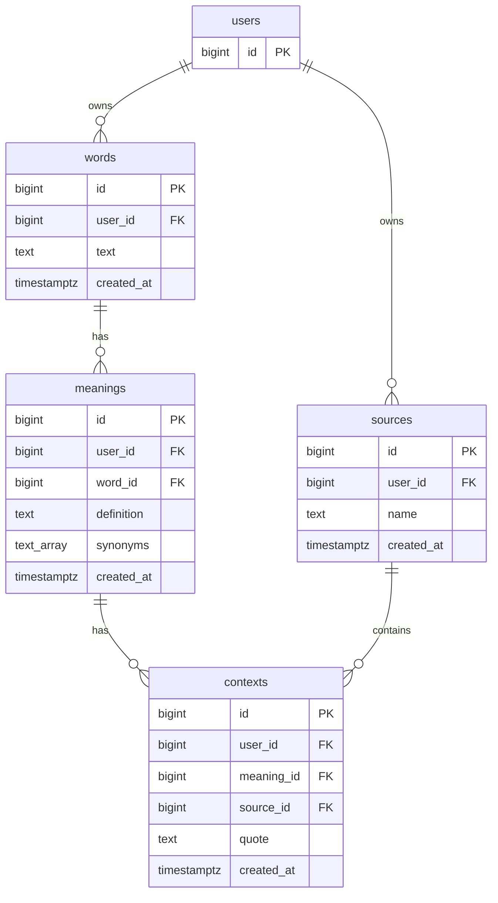

# База данных

[README](../README.md) · [Запуск и миграции](setup.md) · [Архитектура](architecture.md)

Схема и функции находятся в [SQL-миграциях](../internal/storage/postgres/migrations).
Запись выполняется PostgreSQL-функциями; Go-хранилище передаёт аргументы и
читает результаты через параметризованные запросы.

## Сущности и связи



| Таблица | Назначение |
| --- | --- |
| `users` | Пользователи; `id` соответствует Telegram user ID |
| `words` | Слова пользователя с первоначальным написанием |
| `meanings` | Сохранённые определения слова и `synonyms TEXT[] NOT NULL DEFAULT '{}'` |
| `sources` | Названия личных источников: книги, статьи, фильмы и т. п. |
| `contexts` | Контекст конкретного значения в источнике, одним текстовым полем `quote` |

Идентификаторы остальных таблиц — `BIGINT GENERATED ALWAYS AS IDENTITY`.
Все таблицы, кроме `users`, имеют `created_at TIMESTAMPTZ NOT NULL DEFAULT now()`.
`quote` допускает `NULL` в схеме; функция создания нового контекста требует
непустой текст. Чтение поддерживает прежние записи с `NULL`. Отдельной
колонки места после миграции `0006` нет.

Часть речи, примеры из API, антонимы, ссылки на словарь и сведения о лицензии
не сохраняются. Пользовательский контекст хранится в `contexts.quote` и
отличается от примера употребления, полученного из API.

`sources` — источники пользователя. Ссылки Wiktionary и FreeDictionaryAPI.com
служат атрибуцией ответа словаря и не создают строки в `sources`.

## Принадлежность и уникальность

- Слова уникальны по `(user_id, lower(text))`, источники — по
  `(user_id, lower(name))`.
- Значения уникальны по `(user_id, word_id, lower(btrim(definition)))`.
  Разные пользователи могут иметь одинаковые слова, определения и источники.
- Составные внешние ключи включают `user_id`: значение нельзя связать с чужим
  словом, а контекст — с чужим значением или источником.
- Удаление пользователя каскадно удаляет его данные. Удаление слова удаляет
  значения и их контексты; удаление значения или источника удаляет связанные
  контексты. Команд удаления в боте пока нет.
- На пары `(user_id, word_id)` значений, `(user_id, meaning_id)` и
  `(user_id, source_id)` контекстов созданы индексы.

Все функции объявлены `SECURITY INVOKER`, чтение явно фильтруется по
переданному пользователю. RLS в миграциях не настроен: Telegram user ID
передаёт доверенное приложение. SQL-функции сами не аутентифицируют вызывающего.

Проверки входных аргументов функций возвращают SQLSTATE `22023`.
Нарушение внешнего ключа, включая чужого владельца, даёт `23503`;
нарушение уникального индекса при прямой записи — `23505`.

Функции используют `btrim`, который без второго аргумента удаляет обычные
пробелы по краям. Ввод из Telegram предварительно обрабатывается Go
`strings.TrimSpace`. Прямой SQL-вызов не получает эту дополнительную обработку.

## Справочник функций

Все перечисленные сигнатуры доступны после применения миграции `0006`.
Имена аргументов ниже сокращены; порядок соответствует SQL-реализации.

| Сигнатура | Результат |
| --- | --- |
| `add_word_meaning(BIGINT, TEXT, TEXT)` | `word_id BIGINT, meaning_id BIGINT, meaning_created BOOLEAN` |
| `add_word_meaning(BIGINT, TEXT, TEXT, TEXT[])` | Те же поля; четвёртый аргумент задаёт синонимы |
| `list_words(BIGINT, INTEGER, INTEGER)` | `word_id BIGINT, word TEXT` |
| `list_word_meanings(BIGINT, BIGINT)` | `meaning_id BIGINT, definition TEXT, synonyms TEXT[]` |
| `add_source(BIGINT, TEXT)` | `source_id BIGINT, name TEXT, source_created BOOLEAN` |
| `list_sources(BIGINT, INTEGER, INTEGER)` | `source_id BIGINT, name TEXT` |
| `add_context(BIGINT, BIGINT, BIGINT, TEXT)` | `BIGINT`: идентификатор созданного контекста |
| `list_word_contexts(BIGINT, BIGINT)` | `context_id BIGINT, meaning_id BIGINT, source_id BIGINT, source_name TEXT, quote TEXT` |

### Слово, значение и синонимы

```sql
SELECT word_id, meaning_id, meaning_created
FROM add_word_meaning(1001, 'Book', 'Printed work');

SELECT word_id, meaning_id, meaning_created
FROM add_word_meaning(1001, 'Book', 'Printed work', ARRAY['Volume', 'Tome']);
```

В одной атомарной операции создаются отсутствующий пользователь, слово и
значение. Слово и определение очищаются от крайних пробелов; `NULL` и пустые
тексты отклоняются. При повторе определения возвращаются прежние идентификаторы
и `meaning_created = false`; при новом определении — `true`. Первоначальное
написание существующего слова и определения сохраняется.

Синонимы нормализуются в БД: крайние пробелы удаляются, `NULL` и пустые
элементы исключаются, повторы без учёта регистра убираются. Сохраняются
первое написание и порядок.

| Четвёртый аргумент | Новое значение | Существующее значение |
| --- | --- | --- |
| Непустой массив | Нормализованный массив | Замена прежнего массива |
| Пустой массив | Пустой список | Очистка списка |
| SQL `NULL` или трёхаргументный вызов | Пустой список | Сохранение прежних синонимов |

Go-хранилище переводит отсутствующий список в пустой массив: повторный ответ
словаря без синонимов очищает прежний список. Сохраняются только синонимы
самого определения, а не всей группы значений.

Конкурентные вызовы добавления поддерживаются при стандартной изоляции
`READ COMMITTED`. Уникальные индексы защищают от дублей, в том числе при
прямой записи. Атомарность функции не распространяется на последующее
добавление контекста — это отдельная операция.

### Источник и контекст

```sql
SELECT source_id, name, source_created
FROM add_source(1001, 'Dune');
```

Функция создаёт отсутствующего пользователя, обрезает пробелы названия и
находит или создаёт источник. При повторе возвращаются прежние идентификатор
и написание, `source_created = false`; при создании — `true`.

Пример ниже создаёт значение, источник и контекст в одной SQL-транзакции
для демонстрации связей. Бот сохраняет значение отдельно, до ввода контекста.

```sql
BEGIN;

SELECT * FROM add_word_meaning(1001, 'Book', 'Printed work');
SELECT * FROM add_source(1001, 'Dune');

SELECT add_context(1001, m.id, s.id, E'He opened the book.\nChapter 2, page 12')
FROM meanings AS m
JOIN words AS w ON w.user_id = m.user_id AND w.id = m.word_id
JOIN sources AS s ON s.user_id = m.user_id
WHERE m.user_id = 1001
  AND lower(w.text) = 'book'
  AND lower(btrim(m.definition)) = 'printed work'
  AND lower(s.name) = 'dune';

COMMIT;
```

`add_context(user_id, meaning_id, source_id, quote)` проверяет обязательные
идентификаторы и непустой контекст, удаляя крайние пробелы текста.
Содержимое не разбирается: цитата, глава или таймкод могут быть указаны
в любом формате. Функция не проверяет наличие слова в тексте и не удаляет
дубли контекстов: каждый успешный вызов создаёт новую запись. Контексты
одного значения могут ссылаться на разные источники.

### Чтение и страницы

```sql
SELECT word_id, word FROM list_words(1001, 21, 0);
SELECT source_id, name FROM list_sources(1001, 21, 0);

SELECT m.*
FROM words AS w
CROSS JOIN LATERAL list_word_meanings(1001, w.id) AS m
WHERE w.user_id = 1001 AND lower(w.text) = 'book';

SELECT c.*
FROM words AS w
CROSS JOIN LATERAL list_word_contexts(1001, w.id) AS c
WHERE w.user_id = 1001 AND lower(w.text) = 'book';
```

Порядок аргументов списков — `user_id, limit, offset`. `limit` должен быть
положительным, `offset` — неотрицательным; обязательные аргументы не допускают
`NULL`. Слова сортируются по `lower(text), id`, источники — по `lower(name), id`.
Порядок строк зависит от collation базы. Значения и контексты упорядочены по
своим `id`. Неизвестное слово или отсутствие данных пользователя дают пустой
результат; запрос чужого слова не возвращает его значения и контексты.

Бот запрашивает 21 строку и показывает первые 20. Дополнительная строка
определяет наличие следующей страницы; отдельный подсчёт количества не нужен.

## Миграции и откаты

| Версия | Изменение | Откат |
| --- | --- | --- |
| `0001_initial_schema` | Таблицы, связи и исходные индексы | Удаляет все таблицы словаря и их данные |
| `0002_add_word_meaning` | Уникальность определений и функция сохранения | Удаляет функцию и индекс, сохраняет записи |
| `0003_meaning_synonyms` | `TEXT[]` синонимов и четыре аргумента функции; совместимая обёртка | Удаляет синонимы и четырёхаргументную функцию, восстанавливает исходную трёхаргументную |
| `0004_read_words` | Чтение слов и значений | Удаляет две функции чтения |
| `0005_sources_contexts` | Создание и чтение источников и контекстов | Удаляет четыре функции, сохраняет таблицы и данные |
| `0006_unified_context` | Перенос места в текст, удаление `location`, новая сигнатура записи и результат чтения | Возвращает nullable `location` и прежние функции; объединённый текст остаётся в `quote` |

Если перед `0002` уже существуют дубли определений, создание уникального
индекса завершится ошибкой без удаления повторов. `0003` заполняет прежние
значения пустым массивом синонимов. Откат синонимов необратимо теряет именно
эти массивы; слова, определения и контексты сохраняются.

Миграция `0006` дописывает непустое старое место к существующему тексту
через перевод строки с префиксом `Место: `. При отсутствии непустого текста
остаётся только эта строка. Если место отсутствовало или было пустым,
`quote` не меняется, включая прежние `NULL`. Идентификаторы, владельцы,
связи и даты записей сохраняются.

Откат возвращает `location` со значением `NULL` во всех существующих строках,
не пытаясь разделить пользовательский текст. Поэтому повторное применение
не добавляет прежнее место второй раз. Сигнатуры функций несовместимы между
`0005` и `0006`: на время перехода остановите бот, затем запустите версию,
соответствующую схеме.

Инструкции управления миграциями, блокировками и тестовой базой находятся в
[руководстве запуска](setup.md).
